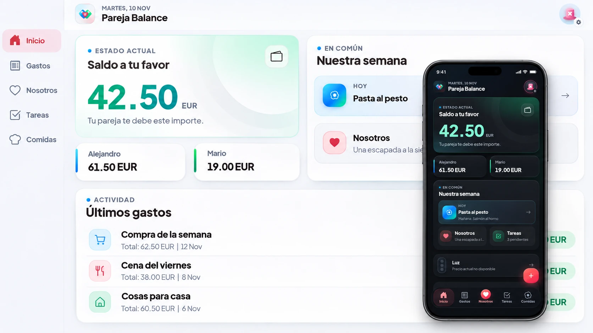

# Pareja Balance · Imagen de porfolio

Versión aprobada: dashboard claro a pantalla completa con un móvil delante mostrando la aplicación en modo oscuro. El nombre de la app queda integrado en la cabecera.

- [WebP optimizada para la web](./pareja-balance-dashboard-movil.webp)
- [PNG original](./pareja-balance-dashboard-movil.png)

Ambos archivos tienen 1672 × 941 píxeles, el tamaño de la imagen anterior de la tarjeta del porfolio.

El PNG puede copiarse como `images/balance.png` en el repositorio del porfolio. Para usar la versión WebP, se debe copiar como `images/balance.webp` y actualizar las referencias de la tarjeta y el modal.

La imagen se creó con ImageGen tomando como referencia el diseño de la app y sus capturas con datos ilustrativos. Es una composición para presentar el proyecto, no una captura literal del diseño de escritorio actual. Véase [el prompt final](./PROMPT-final.md).
